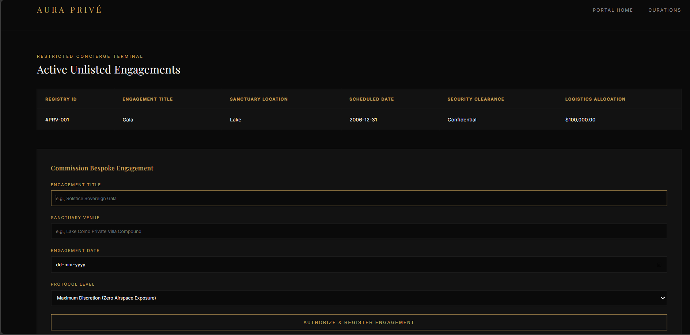
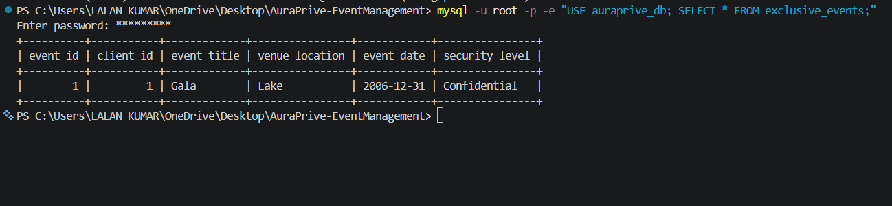

# AURA PRIVÉ — Bespoke Private Event Management Platform

Aura Privé is a private concierge and event curation platform. The system orchestrates zero-exposure gatherings, private island summits, and unlisted estate buyouts with an emphasis on privacy, bespoke logistics, and security protocols.

The application is built on a Core Java backend, utilizing JDBC for relational database persistence, Apache Tomcat for web servlet execution, and a responsive luxury UI.

---

## 1. Application Preview

### Bespoke Client Portal


### Restricted Concierge Terminal & Database Engine



### Live Database Verification via JDBC



---

## 2. Technical Architecture & Core Concepts

The system implements enterprise Java design patterns across the application stack:

### Model-View-Controller (MVC) Architecture

- **Model:** Encapsulates business logic, domain entities, and data validation rules.
- **View:** Responsive JSPs (`index.jsp`, `dashboard.jsp`, `login.jsp`) styled with a minimalist 24K gold and obsidian visual theme.
- **Controller:** `EventServlet.java` & `AuthServlet.java` inspect HTTP request verbs (`GET`, `POST`), coordinate DAO database operations, manage HTTP sessions, and forward data to views.

### Object-Oriented Design (OOP)

- **Interfaces (`SecuredEntity.java`):** Defines formal clearance contracts enforcing verification across high-profile entities.
- **Inheritance & Abstract Classes (`Event.java`):** A root abstraction encapsulating core event attributes (title, sanctuary venue, security level).
- **Polymorphism (`GalaEvent.java`, `SummitEvent.java`):** Specialized subclasses overriding `calculateBaseLogisticsFee()` to dynamically compute custom pricing based on event architecture and VIP volume.
- **Exception Handling (`ExclusiveAccessException.java`):** Custom domain exceptions to intercept security breaches and invalid booking payloads cleanly.

### Collections & Generics

- **Generic Registry (`VIPRegistry<T extends SecuredEntity>`):** Enforces compile-time type safety over Java Collections (`List<T>`). Restricts registry access strictly to entities fulfilling the `SecuredEntity` interface and provides thread-safe access to records.

### Multithreading & Synchronization

- **Asynchronous Service (`DiscreetNotificationService.java`):** Spawns dedicated background worker threads via an `ExecutorService` thread pool to simulate secure dispatch transmissions without blocking the primary HTTP request thread. Utilizes synchronized locks (`synchronized(lock)`) to maintain thread safety across concurrent requests.

### Data Access Layer (JDBC & DAO)

- **Singleton Connection Manager (`DatabaseConnection.java`):** Centralizes MariaDB connection pooling via JDBC drivers, preventing redundant connection overhead.
- **Data Access Object (`EventDAO.java`):** Encapsulates CRUD logic using parameterized `PreparedStatement` queries to prevent SQL injection vulnerabilities, with automatic fallback simulation if the local database is offline[cite: 5].

---

## 3. Directory Architecture

```text
AuraPrive-EventManagement/
│
├── database/
│   └── javapro.sql                              # Relational MariaDB schema & seed records
│
├── docs/
│   ├── landing.png                              # Client portal preview
│   ├── dashboard.png                            # Concierge terminal preview
│   └── database_check.png                       # Terminal JDBC database verification view
│
├── lib/
│   └── mysql-connector-j-8.3.0.jar              # MySQL/MariaDB JDBC connector library
│
├── src/
│   └── main/
│       ├── java/
│       │   └── com/auraprive/
│       │       ├── dao/
│       │       │   ├── DatabaseConnection.java  # Thread-safe JDBC Singleton manager
│       │       │   └── EventDAO.java            # Parameterized database CRUD operations
│       │       ├── exception/
│       │       │   └── ExclusiveAccessException.java # Custom security exception wrapper
│       │       ├── model/
│       │       │   ├── SecuredEntity.java       # Access contract interface
│       │       │   ├── Event.java               # Abstract base domain entity
│       │       │   ├── GalaEvent.java           # Polymorphic implementation subclass
│       │       │   ├── SummitEvent.java         # Second polymorphic subclass
│       │       │   └── VIPRegistry.java         # Type-safe bounded Generic collection
│       │       ├── service/
│       │       │   └── DiscreetNotificationService.java # Thread-pool synchronized worker
│       │       ├── servlet/
│       │       │   ├── EventServlet.java        # Web request dispatcher and CRUD controller
│       │       │   └── AuthServlet.java         # SHA-256 session & authentication controller
│       │       └── SystemVerification.java      # Standalone evaluation runner & embedded server
│       │
│       └── webapp/
│           ├── css/
│           │   └── luxury-style.css             # OKLCH Glassmorphism responsive UI
│           ├── js/
│           │   └── app.js                       # Client interactions
│           ├── index.jsp                        # Client-facing bespoke entry portal
│           ├── login.jsp                        # Secure role-based login & biometric reset gate
│           ├── dashboard.jsp                    # Restricted concierge management interface
│           └── WEB-INF/
│               ├── web.xml                      # Deployment descriptor
│               └── classes/                     # Compiled JVM bytecodes (.class files)
│
├── run-verification.bat                         # One-click compiler, rubric verifier & web launcher
└── README.md                                    # Architectural specification & execution guide
```

## 4. Requirements, Setup & How to Run

Prerequisites
Java Development Kit (JDK): Version 11, 17, or 21+[cite: 5]

Database (Optional): MariaDB or MySQL Server on port 3306. (If MariaDB/MySQL is not installed on the device, the application automatically switches to Offline In-Memory Mode so all features and web pages still work).

## 5. One-Click Launch (Windows)

Extract or clone the AuraPrive-EventManagement folder[cite: 5].

Double-click run-verification.bat[cite: 5].

The script will compile the code, run the 5 backend rubric checks in the terminal, and automatically open http://localhost:8080 in your browser[cite: 5].

Click "Request Private Portfolio" (or visit http://localhost:8080/login.jsp) to sign in and access the Concierge Dashboard[cite: 5].

## 6. Default Evaluator Test Accounts (Passcode: 123456 for all)

Admin / Developer Console: admin@pro.abc (Full CRUD & multi-table access)

Client Portal: client@pro.abc (Isolated private bookings)

Vendor Portal: ven@pro.abc (Read-only logistics schedule)

## 7. Manual Terminal Execution

Run the following commands from the project root directory:

# Compile Java source files with the included JDBC driver

javac -cp "lib/mysql-connector-j-8.3.0.jar;src/main/java" src/main/java/com/auraprive/dao/EventDAO.java src/main/java/com/auraprive/SystemVerification.java

# Run the System Verification Suite & Embedded Web Server

java -cp "lib/mysql-connector-j-8.3.0.jar;src/main/java" com.auraprive.SystemVerification
